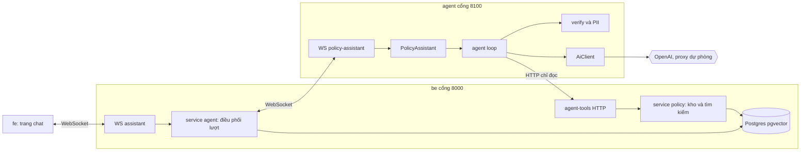
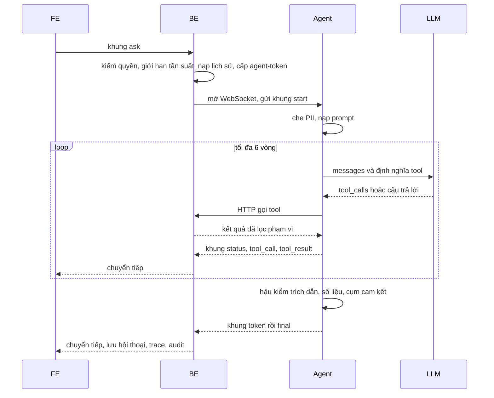

# Design — Agent hỏi đáp (Trợ lý chính sách)

> Kiro spec · Giai đoạn 2/3 · Bản nháp 0.1 · 2026-11-21 · Truy vết về `requirements.md` (`R<n>.<m>`).
> Bản thiết kế sơ bộ đầy đủ hơn về lý do nằm ở `docs/thiet-ke-agent-hoi-dap.md`; khi hai bản khác nhau, bản này (đi cùng requirements) thắng, và **code thắng cả hai**.

## 1. Overview

### 1.1. Cách tiếp cận

Một **agent thật** theo mẫu ReAct: LLM nhận câu hỏi + danh sách tool, tự quyết gọi tool nào, lặp đến khi đủ thông tin rồi trả lời. Phần quyết định "đúng/sai" **không giao cho LLM**: hậu kiểm trích dẫn, kiểm số liệu, ép ngày hiệu lực, ép chủ thể dữ liệu, tính bảng điều kiện tín chỉ đều là code tất định.

### 1.2. Các quyết định chính và lý do

| # | Quyết định | Lý do |
|---|---|---|
| D-1 | Agent là service riêng, **stateless**; BE giữ dữ liệu, hội thoại, kho quy định | Giữ ranh giới HITL và RBAC ở BE; agent sập không mất dữ liệu (CLAUDE.md, ADR) |
| D-2 | Ngữ cảnh cá nhân lấy bằng **tool gọi ngược BE**, chủ thể do BE quyết, tool không có tham số chủ thể | Khớp D2 "LLM tự chọn tool" mà vẫn chặn B5 ngay cả khi bị prompt-injection |
| D-3 | Kho quy định ở **Postgres + pgvector, BE sở hữu**; tìm kiếm lai (full-text + vector, RRF) | Hạ tầng đã có (Supabase); hiệu lực/phiên bản/RLS/audit nằm cùng chỗ; quy mô nhỏ nên không cần vector DB riêng |
| D-4 | **Agent làm embedding** (query và lô chunk khi nạp) | BE không giữ khóa LLM (CLAUDE.md) |
| D-5 | **WebSocket** cho chat (FE↔BE, BE↔agent), tool vẫn **HTTP** | Hai chiều trên một kết nối → có `cancel`; tool ngắn, thử lại được, dễ kiểm quyền và audit từng lời gọi |
| D-6 | Chat Completions tương thích (qua `AiClient`), không dùng Responses API | Đường dự phòng là proxy tương thích Chat Completions; "thinking" hiển thị là kế hoạch ngắn + nhãn tool, không phải chuỗi suy luận thô |
| D-7 | Trả lời dạng văn xuôi với `[cite:chunk_id]`, **không** ép JSON | Cần stream từng token; `citations` dựng bằng code từ kết quả tool |
| D-8 | Chưa có đăng nhập: **người dùng mặc định chỉ ở dev** + dữ liệu giả bằng script seed | Đang làm agent; OAuth không chặn tiến độ. Phần còn lại không đổi khi có đăng nhập |
| D-9 | Ngày hiệu lực do **BE** tính, không nhận từ LLM | LLM không thể bị lừa tra văn bản cũ |

## 2. Architecture

### 2.1. Thành phần



### 2.2. Luồng một lượt hỏi



### 2.3. Ranh giới và hướng phụ thuộc

- **agent**: `runtime → policy_assistant → core → shared`. SDK `openai` chỉ trong `core/`. Không import `vin15`.
- **BE**: `presentation → service → domain`, `infrastructure → domain`; controller đi qua `Container`. Không import `vin15_agent`.
- Hai test `test_architecture.py` của mỗi bên giữ nguyên và được mở rộng (R6, R7).

## 3. Components and Interfaces

### 3.1. Agent (`agent/src/vin15_agent/`)

```
shared/settings.py            + OPENAI_EMBEDDING_MODEL, AGENT_MAX_ROUNDS/TOOL_CALLS/TURN_SECONDS, BE_URL
core/
  ai_client.py                MỞ RỘNG: chat(tools, params theo lần gọi), stream, embed, khả năng từng endpoint
  tools.py                    Tool, ToolSpec, ToolRegistry, to_openai_schema()
  agent_loop.py               vòng lặp tổng quát, giới hạn, song song, hủy
  pii.py                      PiiRedactor
  prompts.py                  PromptLoader (cache, kiểm placeholder)
  tracing.py                  TurnTrace
policy_assistant/
  agent.py                    PolicyAssistant.run(start) -> AsyncIterator[Frame]
  be_client.py                BeToolsClient (httpx; service token + X-On-Behalf-Of)
  tools/                      search_policy.py, get_policy_clause.py, get_my_*.py
  verify.py                   CitationVerifier, NumberChecker, CommitmentGuard
  degraded.py                 degraded_answer()
runtime/http/
  policy_assistant.py         endpoint WebSocket; POST /v1/embeddings
prompts/                      policy_assistant.system.md, citation_rules.md, safeguards.md, refusals.md
```

**`AiClient` (mở rộng, R1, R12, R17):**
```python
class AiClient:
    async def chat(self, messages, *, tools=None, tool_choice="auto", stream=False,
                   temperature=None, max_tokens=None, reasoning_effort=None) -> ChatResult | AsyncIterator[Delta]
    async def embed(self, texts: list[str]) -> list[list[float]]
    def supports(self, capability: Literal["tools", "stream", "embed"]) -> bool
```
- `ChatResult` thêm `tool_calls: list[ToolCall]` và `finish_reason`.
- `LlmEndpoint` thêm tập khả năng; khi chuyển dự phòng chỉ chọn endpoint hỗ trợ đủ khả năng cần dùng, nếu không có thì ném `LlmUnavailableError` (R12.4).
- Tham số theo lần gọi; model suy luận: bỏ `temperature`, nới `max_tokens` (R17.4).

**Khung giữa các bên:** xem mục 3.4.

**Tool (R2, R5, R7):**
```python
class Tool(Protocol):
    name: str
    description: str
    parameters: dict            # JSON schema; cấm trường chủ thể (test)
    read_only: Literal[True]    # bắt buộc
    async def run(self, args: dict, ctx: TurnContext) -> ToolResult
```
`ToolResult` = `{ok, data | error{code,message}, summary}`. Kết quả đưa cho LLM được bọc trong `<tool_result name="...">…</tool_result>` (R8.4).

| Tool | Tham số | BE endpoint |
|---|---|---|
| `search_policy` | `query`, `top_k≤8` | `POST /api/agent-tools/policy/search` |
| `get_policy_clause` | `chunk_id`, `with_neighbors` | `GET /api/agent-tools/policy/chunks/{id}` |
| `get_my_internship` | — | `GET /api/agent-tools/me/internship` |
| `get_my_milestones` | — | `GET /api/agent-tools/me/milestones` |
| `get_my_progress` | — | `GET /api/agent-tools/me/progress` |
| `get_my_credit_checklist` | — | `GET /api/agent-tools/me/credit-checklist` |
| `get_my_requests` | — | `GET /api/agent-tools/me/requests` |

`search_policy` embed `query` bằng `AiClient.embed` rồi gửi `{query, query_vector?, top_k}`; thiếu vector (LLM sập) thì chỉ từ khóa (R2.5).

**Vòng lặp (R1):**
```
rounds = 0
while rounds < MAX_ROUNDS and elapsed < TURN_SECONDS:
    resp = await ai.chat(messages, tools=registry.specs(), ...)
    if not resp.tool_calls: break
    results = await gather(run_tool(c) for c in resp.tool_calls)   # song song, giới hạn tổng ≤ 8
    messages += [resp_message, *results]
    emit(status/tool_call/tool_result)
final = stream_answer(...)         # lượt cuối stream token
final = verify(final, seen_chunks, tool_results)
```
Hủy: mọi `await` nằm trong `asyncio.TaskGroup`/`wait_for`; `cancel` hoặc đóng kết nối hủy group (R1.6).

**Hậu kiểm (`verify.py`, R4, R7):**
- `CitationVerifier`: trích `[cite:ID]`, giữ id ∈ `seen_chunks` (≤ 5); câu về quy định không còn id hợp lệ → thay bằng mẫu "không tìm thấy căn cứ".
- `NumberChecker`: số/thời hạn trong answer ⊆ số trong chunk được trích ∪ kết quả tool; lệch → chặn/sửa.
- `CommitmentGuard`: quét cụm cam kết, viết lại theo mẫu B4.
- `build_citations(seen_chunks, cited_ids)` → danh sách `citations` cho khung `final`.

**Suy giảm (`degraded.py`, R12):** gọi `search_policy` (chỉ từ khóa), lấy top 3 chunk, dựng câu trả lời từ mẫu + nguyên văn, `degraded=true`.

**PII (`core/pii.py`, R11):** `PiiRedactor.redact(text) -> (text, mapping)`; mẫu: email, SĐT VN (`0|+84` + 9 số), MST (10 hoặc 13 số), mã SV theo regex cấu hình. Áp dụng cho câu hỏi, lịch sử, kết quả tool trước khi vào `messages`. `trace` và log chỉ nhận bản đã che.

**Prompt (R17):** `PromptLoader.render("policy_assistant.system", today=…, user_role=…, school_name=…, sample_notice=…)`; ghép `citation_rules`, `safeguards`, `refusals`. Nội dung bản nháp nằm ở `docs/thiet-ke-agent-hoi-dap.md` mục 9.2–9.4.

### 3.2. BE (`be/src/vin15/`)

| Lớp | Thành phần mới |
|---|---|
| `resources/db/migration` | `V2__policy_library.sql`, `V3__assistant_chat.sql`, `V4__internship_minimal.sql` (mục 4) |
| `domain/model` | `PolicyChunk`, `PolicyVersion`, `ChatMessage`, `AgentToolSubject` |
| `service/policy` | `PolicyIngestService` (tách Điều/Khoản), `PolicyPublishService`, `PolicySearchService` (hybrid, RRF, τ), `PolicyChunker` |
| `service/agent` | `AssistantOrchestrator` (điều phối lượt, chuyển tiếp khung, lưu kết quả, audit), `AgentSubjectResolver` (agent-token hoặc người dùng mặc định) |
| `service/progress`, `milestone`, `credit` | Truy vấn đọc cho `get_my_*`; `CreditChecklistService` tính T1–T6 |
| `infrastructure/persistence` | Repository: `PolicyRepository`, `ChatRepository`, đọc hồ sơ/mốc/nhật ký |
| `infrastructure/agent_api` | `AgentApiClient.chat()` (WebSocket, async iterator khung), `embed()` (HTTP) |
| `infrastructure/security` | `ActorTokenService` thêm claim `scope` và kiểm phạm vi |
| `presentation/controller` | `assistant_controller` (WS + ticket + conversations), `agent_tools_controller`, `policy_admin_controller` |
| `config/settings.py` | `AGENT_DEV_DEFAULT_USER_EMAIL`, giới hạn rate, kích thước khung; `validate_production()` từ chối dev default ở production |
| `scripts/seed_dev.py` + `make seed-dev` | Dữ liệu giả (R16) |

Phụ thuộc mới ở BE: thư viện `websockets` (httpx không hỗ trợ WebSocket).

**Tìm kiếm lai (`PolicySearchService.search`, R2):**
```sql
-- (1) lọc hiệu lực, (2) top 20 từ khóa, (3) top 20 vector, (4) RRF k=60
with eligible as (
  select c.* from policy_chunk c join policy_version v on v.id = c.version_id
  where v.status = 'published' and v.effective_from <= :today
    and (v.effective_to is null or :today <= v.effective_to)),
kw as (
  select id, row_number() over (order by ts_rank(tsv, q) desc) r
  from eligible, websearch_to_tsquery('simple', unaccent(:query)) q where tsv @@ q limit 20),
vec as (
  select id, row_number() over (order by embedding <=> :qvec) r, 1 - (embedding <=> :qvec) sim
  from eligible where :qvec is not null and embedding is not null limit 20)
select id, sum(1.0 / (60 + r)) score from (select id, r from kw union all select id, r from vec) s
group by id order by score desc limit :top_k;
```
`no_match` khi `kw` rỗng và `max(sim) < τ`. `:today` luôn do BE tính theo `Asia/Ho_Chi_Minh`.

**Xác thực tool (R6, R16):** `AgentSubjectResolver.resolve(request)`:
1. Kiểm service token; sai → 401.
2. Có `X-On-Behalf-Of` → giải mã, kiểm `scope=agent_tools` và còn hạn → chủ thể = `sub`.
3. Không có và `APP_ENV != production` và `AGENT_DEV_DEFAULT_USER_EMAIL` → chủ thể = người dùng đó; audit `reason='dev-default-user'`.
4. Còn lại → 401.
Mọi endpoint ghi `audit_event` (`actor_kind='agent'`).

**WebSocket FE↔BE (R9):** `WS /api/assistant/ws` — khung đầu `auth{ticket}` (≤ 5 s), kiểm `Origin`; `POST /api/assistant/ws-ticket` cấp ticket một lần ≈ 30 s (RAM, xóa khi dùng) cho người dùng của phiên, hoặc người dùng mặc định ở dev. Handler giữ một `current_turn` mỗi kết nối, `ask` khi đang chạy → `busy`; giới hạn `ask`/phút và số kết nối/người trong handler.

### 3.3. FE (`fe/`)
Trang chat dùng WebSocket: `ws-ticket` → mở → `auth` → `ask`; reducer trạng thái theo `turn_id` (đang chạy, các bước, token, citations, degraded, lỗi); nối lại có backoff, sau nối lại gọi `GET conversations/{id}`; nút dừng gửi `cancel`. Chỉ gọi BE.

### 3.4. Hợp đồng khung (JSON, mọi khung có `type`)

**FE → BE:** `auth{ticket}`, `ask{conversation_id|null, turn_id, question}`, `cancel{turn_id}`, `ping{}`.
**BE → agent (khung duy nhất mở lượt):**
```json
{"type":"start","conversation_id":"c_123","turn_id":"t_9","question":"…",
 "history":[{"role":"user","content":"…"}],
 "actor":{"role":"student","agent_token":"…"},"today":"2026-11-21"}
```
cộng `cancel{}` khi cần. `agent_token` rỗng ở dev (dùng người dùng mặc định).
**Agent → BE → FE:**
| `type` | Nội dung |
|---|---|
| `ready` | `{}` |
| `status` | `{step, text}` |
| `tool_call` | `{name, label}` |
| `tool_result` | `{name, ok, summary}` |
| `token` | `{delta}` |
| `final` | `{answer, citations[], verdict, degraded, usage, trace_id}` |
| `error` | `{code, message}` — `busy, rate_limited, timeout, cancelled, llm_unavailable, internal` |
| `pong` | `{}` |

`citations[i]` = `{chunk_id, doc_title, version, article, clause, effective_from, is_sample, quote}`.
Mã đóng: 1000 xong, 4401 xác thực, 4408 timeout, 4429 giới hạn.

## 4. Data Models

Mọi bảng bật RLS và không tạo policy (BE kết nối bằng role chủ sở hữu), theo mẫu `V1__baseline.sql`.

### 4.1. `V2__policy_library.sql` (R3)
```
create extension if not exists vector;  create extension if not exists unaccent;
policy_document(id, code unique, title, issuer, created_at)
policy_version(id, document_id → policy_document, version_label, effective_from date,
               effective_to date null, status check in ('draft','published','superseded'),
               is_sample bool default false, published_by → app_user, published_at,
               exclude using gist (document_id with =, daterange(effective_from, effective_to,'[]') with &&)
                 where (status='published'))              -- cần btree_gist
policy_chunk(id, version_id → policy_version, ordinal int, article_no text, clause_no text null,
             heading text, text text, tsv tsvector generated always as
               (to_tsvector('simple', unaccent(coalesce(heading,'') || ' ' || text))) stored,
             embedding vector(1536) null, embedding_model text null, unique(version_id, ordinal))
index gin(tsv); (chưa tạo index vector: vài trăm chunk)
```
`chunk_id` hiển thị = `<code>@<version_label>/d<article>[/k<clause>]` (ổn định, đọc được).

### 4.2. `V3__assistant_chat.sql` (R10)
```
chat_conversation(id, user_id → app_user, created_at, title null)
chat_message(id, conversation_id → chat_conversation, turn_id, role check in ('user','assistant'),
             content, citations jsonb default '[]', trace jsonb default '{}', degraded bool default false,
             created_at)
```

### 4.3. `V4__internship_minimal.sql` (R5, R16)
Schema **tối thiểu, đặt tên và cột theo `docs/nghiep-vu-thuc-tap.md` mục 6 và 9** để sau dùng lại (không phải bảng giả): `internship` (user_id, cohort, status theo state machine 6.1, start_date, end_date, mode, lecturer_id), `milestone` (internship_id, code M1–M5, due_date, status), `journal_entry` (internship_id, week_start, submitted_at), `evidence` (milestone_id, status), `request` (internship_id, kind, status). Dữ liệu giả **không** nằm trong migration mà trong `seed_dev.py`.

### 4.4. Mô hình trong bộ nhớ (agent)
`StartFrame`, `TurnContext(actor_role, agent_token, today, seen_chunks: dict[str, Chunk], trace)`, `ToolResult`, `Frame` (Pydantic), `TurnTrace(steps[], tool_calls[], usage, provider, degraded)`.

## 5. Error Handling

| Tình huống | Hành vi | Req |
|---|---|---|
| Tool lỗi/timeout | Trả `{ok:false,error}` cho LLM; lượt tiếp tục | R1.5 |
| Vượt vòng/tool/thời gian | Kết thúc có kiểm soát: câu trả lời tốt nhất hoặc mẫu "chưa xử lý được"; `error: timeout` nếu không có gì | R1.3 |
| `LlmUnavailableError` / endpoint không đủ khả năng | Suy giảm, `degraded=true` | R12 |
| LLM 401/400 (lỗi cấu hình) | Không che: `error: internal`, log rõ ở agent, không lộ khóa | `AiClient` |
| Trích dẫn không hợp lệ / không có căn cứ | Mẫu "không tìm thấy căn cứ" | R4.3 |
| Cam kết kết quả | Viết lại theo mẫu B4 | R7.3 |
| FE rớt giữa lượt | BE chạy hết, lưu `final`; FE lấy lại qua HTTP | R9.7 |
| BE rớt giữa lượt | Agent hủy vòng lặp | R1.6 |
| Ticket sai/quá hạn, sai Origin, sai service token | Đóng 4401 / từ chối bắt tay | R9.2–9.3 |
| Vượt rate limit | `error: rate_limited`, không gọi LLM | R13 |
| `ask` khi đang chạy | `error: busy` | R9.5 |
| Khung quá lớn/không hợp lệ | Đóng 1009/1003, không xử lý | R9.9 |
| Agent-token hết hạn/không khớp | 401 từ tool, audit | R6.5 |

Mọi lỗi đưa ra ngoài đã chuẩn hóa (`code`, `message` tiếng Việt thân thiện), không kèm stack trace/khóa/token. Log chỉ chứa dữ liệu đã che.

## 6. Testing Strategy

### 6.1. Correctness properties

| # | Thuộc tính | Req |
|---|---|---|
| P1 | Mọi tool trong `ToolRegistry` có `read_only=True`; mọi endpoint `/api/agent-tools/*` chỉ là GET hoặc POST tìm kiếm | R6.3, R7.1 |
| P2 | Không schema tool nào chứa trường chủ thể (`user_id`, `student_id`, `email`…) | R5.2 |
| P3 | Mọi `chunk_id` trong `final.citations` ∈ tập chunk các tool trả về trong lượt đó; ≤ 5 | R4.2, R4.4 |
| P4 | Mọi chunk do `search_policy`/`get_policy_clause` trả về thuộc phiên bản `published` và hiệu lực tại hôm nay | R2.1, R2.6 |
| P5 | Với agent-token của SV A, mọi `/api/agent-tools/me/*` chỉ trả dữ liệu của A; không có đường lấy dữ liệu của B | R5.2, R6.2 |
| P6 | Prompt gửi LLM không chứa giá trị PII đã biết của dữ liệu thử (email, SĐT, MST, mã SV) | R11.1 |
| P7 | Vòng lặp luôn kết thúc với ≤ MAX_ROUNDS vòng và ≤ 8 lần gọi tool, kể cả khi LLM giả liên tục yêu cầu tool | R1.2 |
| P8 | Mỗi lời gọi tool sinh đúng một `audit_event` (`actor_kind='agent'`) | R6.4 |
| P9 | Khi LLM không khả dụng, `final.degraded=true` và `answer` chỉ gồm mẫu + nguyên văn chunk | R12.3 |
| P10 | Mọi số trong `answer` đã qua hậu kiểm xuất hiện trong chunk được trích hoặc kết quả tool | R4.5 |
| P11 | Với `APP_ENV=production`, đặt `AGENT_DEV_DEFAULT_USER_EMAIL` làm BE không khởi động; request tool không token luôn 401 | R16.1, R16.3 |
| P12 | `cancel` dừng vòng lặp: sau khi nhận `cancel` không có thêm lời gọi LLM/tool mới | R1.6 |
| P13 | Chạy `seed-dev` hai lần cho cùng kết quả (idempotent); từ chối khi production | R16.5 |
| P14 | Khoảng hiệu lực các bản `published` cùng văn bản không chồng nhau (ràng buộc DB) | R3.5 |

### 6.2. Các tầng kiểm thử

- **Unit (agent)** — LLM giả, BE giả, không mạng, không khóa (NF4): `AiClient` (fallback theo khả năng, tham số model suy luận), vòng lặp (giới hạn, song song, hủy, tool lỗi), `verify` (P3, P10, cam kết), `pii` (P6), `degraded` (P9), `PromptLoader`.
- **Kiến trúc**: agent không import `vin15`; `openai` chỉ trong `core/`; P1, P2; BE không import `vin15_agent`.
- **Unit/integration (BE)**: `PolicyChunker` (Điều/Khoản, tiêu đề), `PolicySearchService` trên Postgres thật có dữ liệu mẫu (P4, `no_match`, chỉ-từ-khóa), ràng buộc không chồng hiệu lực (P14), `AgentSubjectResolver` (P5, P11), audit (P8), RLS cho mọi bảng mới (có test chặn sẵn), `seed-dev` (P13).
- **WebSocket**: bắt tay (ticket, Origin, service token), `busy`, `cancel` (P12), rớt FE/BE, giới hạn kích thước, rate limit theo khung.
- **Đánh giá bằng LLM thật** (`make agent-eval`, không chạy trong CI mặc định): bộ 40–60 câu (R14.2), báo các chỉ số ở R14.3; dùng để chỉnh τ, prompt, model. Kiểm thử đối kháng: hỏi SV khác, "bỏ qua quy tắc", ngoài phạm vi, tiêm lệnh qua dữ liệu giả (tên công ty/nhật ký), đòi lộ prompt, đòi cam kết.
- **FE**: reducer trạng thái chat, nối lại, hiển thị citations/degraded (test thành phần); kiểm tay `rewrites` WebSocket (Q5).

### 6.3. Hiệu năng
Đo p95 thời gian tới khung `token` đầu (NF1) bằng `trace`; mục tiêu chỉnh bằng giới hạn vòng, chạy tool song song và model nhanh. Không tối ưu sớm hơn số đo.
