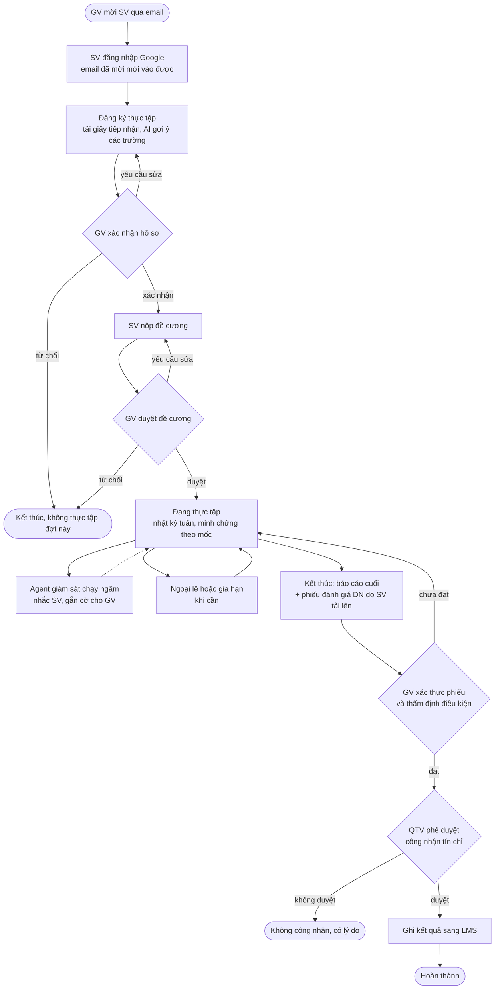
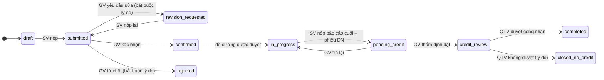
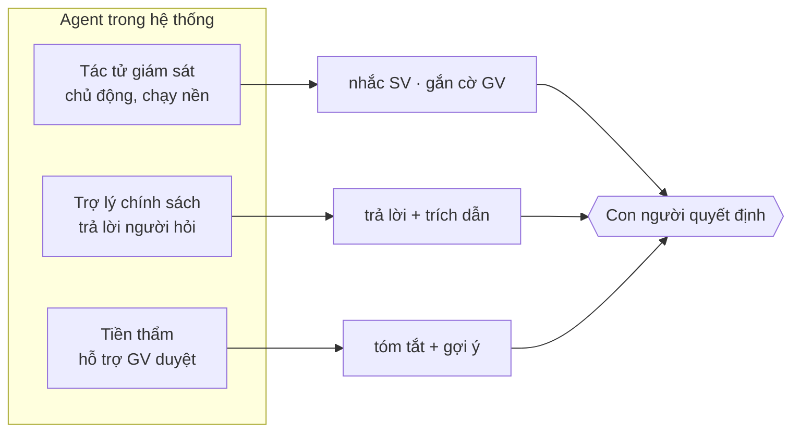
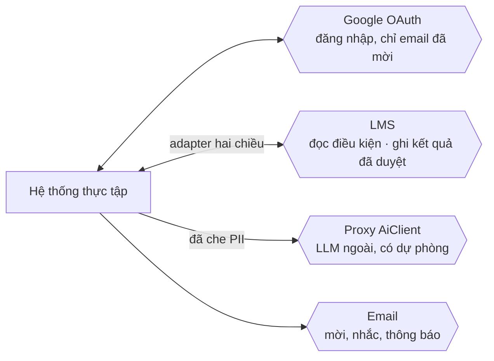

# Phân tích nghiệp vụ — Hệ thống hỗ trợ thực tập bằng AI

> **Trạng thái:** Bản nháp 0.1 · 2026-11-21 · Người soạn: BA (làm lại nghiệp vụ từ đầu, thay toàn bộ PRD/BRIEF cũ đã xóa khỏi nhánh `konan`).
> **Nguồn yêu cầu gốc:** `docs/problem-statement.md` (không đổi). Tài liệu này diễn giải đề bài thành nghiệp vụ chuẩn.
> **Quy ước:** `[ĐÃ CHỐT]` = chủ dự án xác nhận · `[ĐỀ XUẤT]` = BA đề xuất, chờ xác nhận · `[GIẢ LẬP]` = số liệu/quy định mẫu tự soạn, phải thay bằng quy chế thật trước khi vận hành.

---

## 1. Bối cảnh và mục tiêu

### 1.1. Vấn đề

| # | Nỗi đau hiện tại | Ai chịu |
|---|---|---|
| P1 | Câu hỏi về thủ tục, thời hạn, điều kiện công nhận tín chỉ lặp lại hàng loạt | Giảng viên, phòng đào tạo |
| P2 | Hồ sơ đăng ký thiếu/sai, bị trả lại nhiều vòng | Sinh viên, giảng viên |
| P3 | Theo dõi nhật ký, minh chứng, mốc bằng tay (bảng tính, email) | Giảng viên |
| P4 | Phát hiện sinh viên trễ hạn hoặc lệch chuẩn đầu ra quá muộn | Giảng viên, sinh viên |
| P5 | Ngoại lệ và công nhận tín chỉ xử lý rời rạc, không lưu vết | Phòng đào tạo |
| P6 | Không có bức tranh toàn khóa về chất lượng thực tập | Phòng đào tạo |

### 1.2. Mục tiêu

1. Giảm tải câu hỏi lặp bằng trợ lý trả lời đúng ngữ cảnh từng sinh viên, **luôn trích dẫn văn bản đang hiệu lực**.
2. Chuẩn hóa hồ sơ ngay từ đầu để giảm số vòng trả lại.
3. Phát hiện sớm rủi ro (trễ hạn, thiếu minh chứng, lệch chuẩn đầu ra, thiếu điều kiện công nhận tín chỉ) bằng **tác tử giám sát chủ động**.
4. Mọi quyết định mang tính học thuật do **con người** đưa ra và có lưu vết.
5. Cho phòng đào tạo thấy toàn khóa.

### 1.3. Nguyên tắc bất biến (non-negotiables)

| Mã | Nguyên tắc | Cách bảo đảm |
|---|---|---|
| N1 | **HITL**: duyệt đề cương, xử lý ngoại lệ, công nhận tín chỉ phải do giảng viên/quản trị viên quyết | Ràng buộc trong code (state machine), không chỉ trong prompt. Agent không có quyền đổi các trạng thái này. |
| N2 | **Trích dẫn đúng**: câu trả lời chính sách chỉ dựa trên văn bản đang có hiệu lực; không có nguồn thì nói "không biết" | Chỉ truy hồi văn bản hiệu lực theo ngày; kiểm từng câu có bám nguồn |
| N3 | **Bảo mật**: dữ liệu ai chỉ thấy phạm vi của người đó; PII được che trước khi ra LLM ngoài | RBAC theo phạm vi, lớp che PII, audit |
| N4 | **Có lưu vết**: mọi thay đổi trạng thái và quyết định ghi vào nhật ký chỉ-thêm (append-only) | Bảng audit không sửa/xóa được |

---

## 2. Các quyết định đã chốt

| # | Chủ đề | Quyết định | Trạng thái |
|---|---|---|---|
| D1 | Bản chất dự án | **Sản phẩm thật cho một trường** | ĐÃ CHỐT |
| D2 | Định nghĩa "AI Agent" | **Agent thật**: LLM tự lập kế hoạch và chọn tool; mọi thao tác ghi quan trọng qua HITL | ĐÃ CHỐT |
| D3 | Vai trò | Sinh viên · Giảng viên phụ trách · Quản trị viên / phòng đào tạo | ĐÃ CHỐT |
| D4 | Phạm vi | **Làm hết, một đợt phát hành**: cổng hồ sơ + theo dõi mốc · trợ lý chính sách · tác tử giám sát · ngoại lệ có lưu vết + công nhận tín chỉ + dashboard + LMS | ĐÃ CHỐT |
| D5 | Quy mô | Dưới 200 sinh viên mỗi khóa | ĐÃ CHỐT |
| D6 | Quy chế | **Chưa có văn bản thật** → dùng bộ mẫu tự soạn | ĐÃ CHỐT (xem rủi ro R1) |
| D7 | Đánh giá từ doanh nghiệp | **Sinh viên tải phiếu có xác nhận của doanh nghiệp, giảng viên xác thực.** Doanh nghiệp không có tài khoản | ĐÃ CHỐT |
| D8 | LMS | **Hai chiều**: đọc danh sách SV/học phần/điểm để kiểm điều kiện; ghi kết quả quy đổi ngược lại **sau khi đã được duyệt** | ĐÃ CHỐT |
| D9 | Đăng nhập | **Google OAuth thường.** Sinh viên do giảng viên **mời qua email**; email chưa được mời đăng nhập không có hiệu lực | ĐÃ CHỐT |
| D10 | LLM | Gọi LLM ngoài qua **một lớp proxy `AiClient`** (mẫu theo repo `Neviads/neviad4_5`: giao diện trung lập nhà cung cấp, chuỗi dự phòng, gọi tool có giới hạn) | ĐÃ CHỐT |
| D11 | Quyền tự quyết của agent | Agent **được tự gửi nhắc nhở** và **gắn cờ rủi ro**; mọi **quyết định** cần người | ĐÃ CHỐT |
| D12 | Công nhận tín chỉ | **GV thẩm định, QTV phê duyệt cuối** rồi mới ghi LMS | ĐÃ CHỐT |
| D13 | Ngoại lệ | **GV duyệt loại thường; QTV duyệt loại ảnh hưởng tín chỉ** | ĐÃ CHỐT |
| D14 | Chuỗi mời tài khoản | **QTV mời GV, GV mời SV.** QTV khởi tạo khai báo qua cấu hình `APP_ADMIN_EMAILS` (nhiều email, cách nhau dấu phẩy) | ĐÃ CHỐT |
| D15 | Kênh cảnh báo tới GV | **Trong ứng dụng + email tổng hợp mỗi ngày** (cờ nghiêm trọng có thể gửi ngay) | ĐÃ CHỐT |

---

## 3. Phạm vi

### 3.1. Trong phạm vi (một đợt phát hành)

| Nhóm | Nội dung | Mức đề bài |
|---|---|---|
| **A. Cổng hồ sơ và theo dõi mốc** | Mời + đăng nhập; đăng ký thực tập có chuẩn hóa hồ sơ bằng AI; đề cương; mốc, nhật ký tuần, minh chứng; danh sách tổng hợp có lọc/xuất | Cơ bản |
| **B. Trợ lý chính sách** | Hỏi đáp theo ngữ cảnh cá nhân, trích dẫn điều khoản, từ chối khi không có căn cứ | Cơ bản |
| **C. Tác tử giám sát** | Chủ động quét tiến độ và tuân thủ; nhắc sinh viên; gắn cờ cho giảng viên; tiền thẩm hồ sơ cho giảng viên | Nâng cao |
| **D. Ngoại lệ, tín chỉ, dashboard, LMS** | Ngoại lệ có lưu vết; thẩm định và công nhận quy đổi tín chỉ; dashboard toàn khóa; đồng bộ LMS hai chiều | Nâng cao |
| **X. Xuyên suốt** | Phân quyền theo phạm vi, audit, che PII, thư viện quy định, thông báo | Bắt buộc |

### 3.2. Ngoài phạm vi `[ĐỀ XUẤT]`

- Tài khoản và giao diện riêng cho doanh nghiệp/mentor (D7).
- Đa trường, đa khoa với phân quyền theo đơn vị (D5: dưới 200 sinh viên).
- Ứng dụng di động bản địa (web đáp ứng màn hình nhỏ là đủ).
- Giao diện đa ngôn ngữ (chỉ tiếng Việt).
- Tự động duyệt/từ chối bất kỳ quyết định học thuật nào (N1).
- Tìm và giới thiệu doanh nghiệp thực tập; quản lý hợp đồng/bảo hiểm.
- Chấm điểm thực tập bằng AI.

### 3.3. Giả định

- Múi giờ nghiệp vụ `Asia/Ho_Chi_Minh`; hạn nộp tính theo múi giờ này.
- Một sinh viên có tối đa **một** đợt thực tập đang hoạt động mỗi khóa.
- Mỗi sinh viên có đúng **một** giảng viên phụ trách tại một thời điểm.
- Mọi sinh viên dùng email Google (cá nhân hoặc của trường) để đăng nhập.

---

## 4. Các bên liên quan và quyền hạn

### 4.1. Vai trò

| Vai trò | Mô tả | Thấy dữ liệu của |
|---|---|---|
| **Sinh viên** | Chủ hồ sơ thực tập của mình | Chỉ của mình |
| **Giảng viên phụ trách** | Hướng dẫn và duyệt cho sinh viên được phân công | Sinh viên mình phụ trách |
| **Quản trị viên / phòng đào tạo** | Cấu hình, quy định, phê duyệt cấp cao, xem toàn khóa | Toàn bộ |
| **Agent (tác nhân hệ thống)** | Không phải người dùng; có danh tính riêng trong audit (`actor_kind = agent`) | Theo công cụ được cấp |
| **Doanh nghiệp** | Ngoài hệ thống; chỉ xuất hiện qua phiếu đánh giá do sinh viên tải lên | — |

### 4.2. Ma trận quyền (CRUD rút gọn)

| Chức năng | SV | GV | QTV | Agent |
|---|---|---|---|---|
| Mời sinh viên | — | ✔ (SV mình phụ trách) | ✔ | — |
| Mời giảng viên | — | — | ✔ | — |
| Khai báo/sửa hồ sơ, nộp | ✔ (của mình) | — | — | Gợi ý trường, **không nộp** |
| Xác nhận hồ sơ | — | ✔ | — | Tiền thẩm (gợi ý) |
| Duyệt đề cương | — | ✔ | — | Tóm tắt (gợi ý) |
| Nộp nhật ký, minh chứng | ✔ | — | — | Đọc và đánh giá sơ bộ |
| Chấp nhận / trả lại minh chứng | — | ✔ | — | Gợi ý |
| Xem/trả lời cờ rủi ro | — | ✔ | ✔ | **Tạo cờ** |
| Gửi nhắc nhở | — | ✔ (thủ công) | ✔ | **✔ tự gửi cho chính SV đó** |
| Duyệt gia hạn mốc | — | ✔ | — | Tóm tắt (gợi ý) |
| Xử lý ngoại lệ | Tạo yêu cầu | Duyệt loại thường | Duyệt loại ảnh hưởng tín chỉ | Tóm tắt (gợi ý) |
| Công nhận tín chỉ | — | Thẩm định | Phê duyệt | Kiểm điều kiện (gợi ý) |
| Quản lý quy định, mốc mẫu, khóa | — | — | ✔ | — |
| Xem dashboard toàn khóa | — | Phạm vi mình | ✔ | — |

> Quy tắc vàng: cột **Agent** không bao giờ có quyền "quyết" (xác nhận, duyệt, chấp nhận, công nhận, phê duyệt).

---

## 5. Quy trình nghiệp vụ từ đầu đến cuối

### 5.1. Vòng đời một đợt thực tập

### 5.2. Ai làm gì ở từng bước

| Bước | Hành động | Người thực hiện | Điểm HITL |
|---|---|---|---|
| 1 | Mời sinh viên | GV (hoặc QTV) | — |
| 2 | Đăng nhập lần đầu | SV | — |
| 3 | Đăng ký, tải giấy tiếp nhận | SV | AI chỉ gợi ý, **SV bấm xác nhận từng trường** |
| 4 | Xác nhận hồ sơ | GV | **HITL** |
| 5 | Nộp và duyệt đề cương | SV → GV | **HITL** |
| 6 | Thực hiện: nhật ký, minh chứng | SV | GV chấp nhận minh chứng (**HITL**) |
| 7 | Giám sát chủ động | Agent | Agent gắn cờ, GV quyết |
| 8 | Gia hạn, ngoại lệ | SV tạo → GV/QTV | **HITL** |
| 9 | Phiếu đánh giá DN | SV tải → GV xác thực | **HITL** |
| 10 | Công nhận tín chỉ | GV thẩm định → QTV duyệt | **HITL** |
| 11 | Đồng bộ LMS | Hệ thống | Chỉ ghi **sau** bước 10 |

---

## 6. Trạng thái và quy tắc chuyển trạng thái

### 6.1. Hồ sơ thực tập

### 6.2. Các thực thể có luồng duyệt khác

| Thực thể | Luồng | Người quyết |
|---|---|---|
| Đề cương | `submitted → approved / revision_requested / rejected` | GV |
| Mốc | `pending → submitted → accepted / rejected`; `pending/rejected → overdue` (hệ thống) | GV chấp nhận; **hệ thống đánh dấu quá hạn** |
| Gia hạn mốc | `open → approved / rejected / cancelled` | GV |
| Ngoại lệ | `open → approved / rejected / cancelled` | GV (loại thường) hoặc QTV (loại ảnh hưởng tín chỉ) |
| Cờ rủi ro | `open → acknowledged / resolved / dismissed` | GV/QTV (agent chỉ tạo) |

### 6.3. Quy tắc chung

- **BR-S1.** Chỉ cạnh do người dùng đúng vai trò **và** đúng phạm vi (GV phụ trách, SV chủ hồ sơ) mới đi được. Agent và job nền gọi vào cạnh quyết định bị từ chối.
- **BR-S2.** Quyết định "từ chối", "yêu cầu sửa", "không duyệt" **bắt buộc có lý do**.
- **BR-S3.** Mọi chuyển trạng thái ghi một bản ghi audit (ai, vai trò, trước/sau, lý do, thời điểm).
- **BR-S4.** Nội dung đã nộp không bị sửa tại chỗ sau khi nộp; sửa = tạo phiên bản mới.

---

## 7. Yêu cầu nghiệp vụ chi tiết

### Nhóm A — Cổng hồ sơ và theo dõi mốc

| Mã | Yêu cầu | Ưu tiên |
|---|---|---|
| A1 | GV nhập danh sách email để mời SV; SV đăng nhập bằng đúng email đó. Email chưa mời: từ chối, không tạo tài khoản. | Must |
| A2 | GV có thể thu hồi lời mời trước khi SV đăng nhập, và khóa tài khoản sau đó. | Must |
| A3 | SV khai báo hồ sơ: doanh nghiệp (tên, MST, địa chỉ), vị trí, người hướng dẫn (tên, email, SĐT), thời gian, hình thức, mô tả công việc. | Must |
| A4 | SV tải giấy tiếp nhận (PDF/ảnh); hệ thống trích trường, **hiển thị nguồn và độ tin cậy**, SV xác nhận từng trường. | Must |
| A5 | Kiểm tra hồ sơ trước khi nộp theo quy định hiện hành (thời lượng tối thiểu, mốc thời gian hợp lệ, trường bắt buộc). Lỗi nêu rõ **trích dẫn điều khoản**. | Must |
| A6 | Phát hiện và cảnh báo doanh nghiệp trùng/MST không hợp lệ. | Should |
| A7 | Đề cương: nộp, xem phiên bản, nhận phản hồi; có phần đối chiếu **chuẩn đầu ra** của học phần. | Must |
| A8 | Mốc theo khóa (mẫu do QTV cấu hình), mỗi mốc có hạn, trạng thái và dòng "việc cần làm tiếp". | Must |
| A9 | Nhật ký tuần: nộp theo tuần, có hạn; GV xem và nhận xét. | Must |
| A10 | Minh chứng: tải tệp PDF/DOCX/ảnh có kiểm tra loại tệp thật; mọi tệp lưu riêng tư, truy cập qua kiểm quyền. | Must |
| A11 | Danh sách tổng hợp cho GV/QTV: lọc theo trạng thái, mốc, rủi ro; xuất CSV/Excel. | Must |
| A12 | Hàng chờ duyệt của GV, xếp theo mức ưu tiên (hạn gần, rủi ro cao). | Should |
| A13 | Thông báo trong ứng dụng, kèm email cho việc có hạn. | Must |

### Nhóm B — Trợ lý chính sách

| Mã | Yêu cầu | Ưu tiên |
|---|---|---|
| B1 | Trả lời câu hỏi về thủ tục, thời hạn, điều kiện, **theo ngữ cảnh cá nhân** (khóa, mốc hiện tại, trạng thái hồ sơ của chính SV hỏi). | Must |
| B2 | Mỗi câu trả lời có trích dẫn tới điều/khoản của **văn bản đang có hiệu lực tại ngày hỏi**. | Must |
| B3 | Không có căn cứ trong văn bản: nói rõ "không tìm thấy" và chỉ đường tới GV; **không bịa**. | Must |
| B4 | Câu hỏi đòi quyết định ("em có được công nhận không?"): giải thích quy định, **không cam kết kết quả**, hướng dẫn tạo yêu cầu để người duyệt. | Must |
| B5 | Từ chối: hỏi dữ liệu SV khác, yêu cầu bỏ qua quy tắc, ngoài phạm vi thực tập. | Must |
| B6 | Văn bản quy định có phiên bản và ngày hiệu lực; văn bản hết hiệu lực không được dùng để trả lời. | Must |
| B7 | Trả lời dạng stream; có chỉ báo khi chờ. | Should |
| B8 | Lưu lịch sử hội thoại theo từng người dùng. | Should |

### Nhóm C — Tác tử giám sát và tiền thẩm

| Mã | Yêu cầu | Ưu tiên |
|---|---|---|
| C1 | Agent chạy định kỳ (mỗi ngày) và khi có sự kiện (nộp, trả lại, quá hạn). | Must |
| C2 | Phát hiện: **quá hạn mốc**, **thiếu nhật ký**, **thiếu/yếu minh chứng**, **công việc lệch chuẩn đầu ra**, **thiếu điều kiện công nhận tín chỉ** (kể cả điều kiện đọc từ LMS). | Must |
| C3 | **Tự gửi nhắc nhở cho chính SV** theo mẫu và giới hạn chống spam (xem 8.3). | Must |
| C4 | **Gắn cờ rủi ro** cho GV phụ trách, nêu **lý do, bằng chứng và gợi ý hành động**. Cờ không lặp khi chưa có thay đổi. | Must |
| C5 | Agent **không đổi bất kỳ trạng thái nào** của hồ sơ, đề cương, mốc, ngoại lệ, tín chỉ. | Must |
| C6 | Tiền thẩm cho GV: tóm tắt đề cương, so khớp chuẩn đầu ra, kiểm minh chứng (nhận diện trùng, thiếu nội dung), đánh dấu là "gợi ý của AI". | Should |
| C7 | Mọi hành động của agent (gọi công cụ, nhắc, cờ) ghi vết kèm lý do. | Must |
| C8 | GV bác bỏ cờ kèm lý do; agent không tái tạo cờ đã bác nếu điều kiện chưa đổi. | Must |

### Nhóm D — Ngoại lệ, tín chỉ, dashboard, LMS

| Mã | Yêu cầu | Ưu tiên |
|---|---|---|
| D1 | SV tạo yêu cầu **gia hạn mốc** hoặc **ngoại lệ** kèm lý do và minh chứng; theo dõi trạng thái. | Must |
| D2 | Loại ngoại lệ do QTV định nghĩa theo danh mục; mỗi loại gắn cờ "ảnh hưởng tín chỉ" hay không, từ đó quyết định GV hay QTV duyệt (D13). Danh mục cụ thể: xem Q2. | Must |
| D3 | Người duyệt thấy tóm tắt AI + lịch sử; quyết định có lý do và được lưu vết đầy đủ. | Must |
| D4 | Thẩm định công nhận tín chỉ: hệ thống tính **bảng điều kiện đạt/chưa đạt** (xem 9.2) để GV thẩm định; QTV phê duyệt cuối. | Must |
| D5 | LMS: đọc danh sách SV, học phần đã học, điểm để kiểm điều kiện tiên quyết. | Must |
| D6 | LMS: ghi kết quả quy đổi **chỉ sau khi QTV duyệt**; có trạng thái đồng bộ, thử lại, và cảnh báo khi lỗi. | Must |
| D7 | Dashboard toàn khóa cho QTV (và GV trong phạm vi): tiến độ, tỷ lệ trễ hạn, rủi ro, thời gian ra quyết định, kết quả công nhận. | Must |
| D8 | Xuất báo cáo dashboard. | Should |

### Nhóm X — Xuyên suốt

| Mã | Yêu cầu |
|---|---|
| X1 | Mọi API kiểm quyền theo vai trò **và phạm vi dữ liệu**. |
| X2 | Audit chỉ-thêm cho mọi thay đổi trạng thái, quyết định, từ chối truy cập, hành động của agent. |
| X3 | PII (họ tên, mã SV, email, SĐT, MST) được che trước khi gửi ra LLM ngoài; không gửi nội dung không cần cho việc đang làm. |
| X4 | Giới hạn tần suất cho đăng nhập, hỏi đáp, tải tệp. |
| X5 | Khi LLM không khả dụng: hệ thống vẫn chạy ở chế độ suy giảm (trích nguyên văn quy định; giám sát theo luật), không bịa. |

---

## 8. Agent: hành vi nghiệp vụ

### 8.1. Ba agent

| Agent | Kích hoạt | Mục tiêu | Tự làm | Không được làm |
|---|---|---|---|---|
| **Giám sát** | Lịch + sự kiện | Phát hiện sớm rủi ro | Đọc dữ liệu; nhắc SV; tạo cờ | Đổi trạng thái, nhắn người ngoài hệ thống, sửa dữ liệu |
| **Trợ lý chính sách** | Người dùng hỏi | Giải đáp có trích dẫn | Tra quy định, đọc ngữ cảnh của **chính người hỏi** | Cam kết kết quả, xem dữ liệu người khác, tạo yêu cầu thay SV |
| **Tiền thẩm** | GV mở hồ sơ/hàng chờ | Giảm công đọc cho GV | Tóm tắt, so khớp, kiểm minh chứng | Chấp nhận/trả lại thay GV |

### 8.2. Danh mục công cụ ở mức nghiệp vụ

| Nhóm công cụ | Ví dụ | Loại | Cần HITL |
|---|---|---|---|
| Đọc hồ sơ/mốc/nhật ký/minh chứng | trạng thái, mốc quá hạn, nhật ký thiếu | Đọc | Không |
| Tra quy định | tìm điều khoản còn hiệu lực | Đọc | Không |
| Đọc LMS | học phần đã học, điểm | Đọc | Không |
| Gửi nhắc nhở cho SV | nhắc nộp, nhắc hạn | Ghi mức thấp | **Không** (D11), có giới hạn tần suất |
| Gắn cờ rủi ro | cờ kèm lý do, bằng chứng | Ghi mức thấp | **Không** (D11) |
| Soạn nháp | nháp yêu cầu gia hạn cho SV xem | Ghi nháp | SV phải tự gửi |
| Đổi trạng thái / duyệt / công nhận / ghi LMS | — | Quyết định | **Agent không có công cụ này** |

> Cách chặn: agent không được cấp công cụ quyết định; ngoài ra state machine từ chối actor không phải người. Hai lớp độc lập.

### 8.3. Quy tắc nhắc nhở (chống spam) `[ĐỀ XUẤT]`

- Mỗi (SV, mốc, loại lý do) nhắc **tối đa 1 lần/ngày** và **tối đa 3 lần** trong một mốc.
- Lần nhắc thứ 3 mà SV chưa phản hồi: tự động **leo thang thành cờ cho GV**.
- Nội dung nhắc dùng mẫu cố định, chỉ điền tên mốc/hạn; không để LLM viết tự do lời nhắn gửi đi.
- Không nhắc ngoài khung giờ 07:00–21:00 (múi giờ nghiệp vụ).

### 8.4. Tiêu chí gắn cờ `[ĐỀ XUẤT]`

| Loại cờ | Điều kiện | Mức |
|---|---|---|
| Quá hạn mốc | Quá hạn ≥ 1 ngày, chưa nộp | Cảnh báo; ≥ 7 ngày: nghiêm trọng |
| Thiếu nhật ký | ≥ 2 tuần liên tiếp chưa nộp | Cảnh báo |
| Minh chứng yếu | Tệp trùng, rỗng hoặc không khớp mốc | Thông tin |
| Lệch chuẩn đầu ra | Mô tả công việc/nhật ký không phủ chuẩn đầu ra đã khai | Cảnh báo |
| Thiếu điều kiện tín chỉ | Dự báo không đủ điều kiện ở 9.2 khi còn ≤ 2 tuần | Nghiêm trọng |

---

## 9. Quy tắc nghiệp vụ mẫu `[GIẢ LẬP]`

> Toàn bộ mục này là **số liệu mẫu tự soạn** (D6). Khi có quy chế thật, thay bằng văn bản thật được QTV nhập vào thư viện quy định; **không đổi code**.

### 9.1. Mốc mặc định

| # | Mốc | Hạn (tính từ ngày bắt đầu thực tập) |
|---|---|---|
| M1 | Hồ sơ đăng ký được xác nhận | Trước ngày bắt đầu |
| M2 | Đề cương được duyệt | Tuần 2 |
| M3 | Báo cáo giữa kỳ | Giữa kỳ |
| M4 | Báo cáo cuối kỳ | Tuần cuối |
| M5 | Phiếu đánh giá của doanh nghiệp | Trong 5 ngày làm việc sau khi kết thúc |

### 9.2. Điều kiện công nhận quy đổi tín chỉ

| Mã | Điều kiện | Nguồn dữ liệu |
|---|---|---|
| T1 | Thời lượng thực tế ≥ mức tối thiểu của quy định | Hồ sơ + nhật ký |
| T2 | Đề cương đã được duyệt | Hệ thống |
| T3 | Mọi mốc bắt buộc ở trạng thái `accepted` | Hệ thống |
| T4 | Tỷ lệ tuần có nhật ký ≥ ngưỡng | Hệ thống |
| T5 | Phiếu đánh giá DN đã được GV xác thực và đạt ngưỡng | Phiếu tải lên + GV |
| T6 | Đủ điều kiện tiên quyết học phần | **LMS** |

Hệ thống chỉ **hiển thị đạt/chưa đạt từng điều kiện**; kết luận công nhận do người quyết.

---

## 10. Dữ liệu, bảo mật, tích hợp

### 10.1. Phân loại dữ liệu

| Loại | Ví dụ | Xử lý |
|---|---|---|
| PII sinh viên | Họ tên, mã SV, email, SĐT, điểm | Che trước khi gửi LLM; chỉ chủ thể và GV phụ trách xem |
| Thông tin doanh nghiệp | Tên, MST, địa chỉ, người hướng dẫn | Như trên |
| Tệp minh chứng | Giấy tiếp nhận, báo cáo, phiếu đánh giá | Lưu riêng tư, truy cập qua kiểm quyền, tên tệp không lộ nội dung |
| Dữ liệu quy định | Văn bản, điều khoản, hiệu lực | Công khai trong nội bộ |
| Audit | Ai làm gì | Chỉ-thêm, QTV xem |

### 10.2. Tích hợp

| Tích hợp | Quy tắc nghiệp vụ |
|---|---|
| **Google OAuth** | Có tài khoản Google chưa đủ: email phải nằm trong danh sách đã mời và chưa thu hồi. Vai trò do hệ thống gán, không lấy từ Google. |
| **LMS** | Đặt sau một lớp adapter chuẩn; chưa biết LMS cụ thể → chạy được bằng adapter mô phỏng. Ghi LMS chỉ sau phê duyệt (D8). |
| **Proxy AiClient** | Mọi cuộc gọi LLM đi qua một chỗ; trình duyệt không gọi LLM; có chuỗi nhà cung cấp dự phòng; gọi tool có giới hạn số lần; đầu ra có cấu trúc. Che PII ở lớp này. |

### 10.3. Lưu trữ và quyền riêng tư `[ĐỀ XUẤT]`

- Dữ liệu cá nhân xử lý theo **Nghị định 13/2023/NĐ-CP** về bảo vệ dữ liệu cá nhân — cần bộ phận pháp chế của trường xác nhận trước khi vận hành (xem R2).
- Thời hạn lưu hồ sơ, tệp và hội thoại: chưa chốt (Q6).
- Sinh viên có quyền xem dữ liệu của mình và yêu cầu xóa trong phạm vi quy định cho phép.

---

## 11. Yêu cầu phi chức năng và chỉ số thành công

### 11.1. Phi chức năng `[ĐỀ XUẤT]`

| Mã | Yêu cầu |
|---|---|
| NF1 | Trợ lý trả lời có trích dẫn trong p95 ≤ 5 giây khi có LLM; có đường suy giảm khi hết ngân sách thời gian |
| NF2 | Hệ thống phục vụ ≥ 200 người dùng đồng thời mà không suy giảm đáng kể |
| NF3 | Toàn bộ truyền tải qua HTTPS; giới hạn tần suất ở các điểm nhạy cảm |
| NF4 | Sao lưu dữ liệu hằng ngày; khôi phục được trong ngày |
| NF5 | Giao diện tiếng Việt, dùng được trên máy tính và điện thoại |
| NF6 | Mọi quyết định học thuật truy vết được tới một người cụ thể |

### 11.2. Chỉ số thành công (mục tiêu, **chưa đo**)

| Chỉ số | Mục tiêu |
|---|---|
| Câu trả lời trích đúng điều khoản (mẫu kiểm) | ≥ 90% |
| Câu hỏi đối kháng bị từ chối đúng | 100% |
| Số lần agent đổi trạng thái quyết định | **0** |
| Mốc quá hạn được cảnh báo trước | ≥ 80% |
| Cờ bị GV bác vì sai | ≤ 15% |
| Thời gian ra quyết định trung vị | ≤ 3 ngày làm việc |
| Số vòng trả lại hồ sơ trung bình | Giảm so với trước khi dùng (cần đo nền) |

---

## 12. Truy vết đề bài → yêu cầu

| Yêu cầu trong đề bài | Mã yêu cầu |
|---|---|
| Khai báo và chuẩn hóa hồ sơ | A3, A4, A5, A6 |
| Theo dõi trạng thái từng mốc, danh sách tổng hợp | A8, A9, A11, A12 |
| Trợ lý giải đáp có trích dẫn nguồn | B1–B8 |
| Hướng dẫn theo ngữ cảnh cá nhân | B1 |
| Tác tử giám sát chủ động; nhắc việc và cảnh báo | C1–C8 |
| Phát hiện lệch chuẩn đầu ra | A7, C2 |
| Phê duyệt đề cương bắt buộc HITL | N1, 6.2, A7 |
| Ngoại lệ có lưu vết | D1–D3, X2 |
| Công nhận quy đổi tín chỉ HITL | D4, 9.2 |
| Đồng bộ LMS | D5, D6 |
| Dashboard phân tích toàn khóa | D7, D8 |
| Bảo mật thông tin SV và DN | N3, X1, X3, 10.1 |
| SSO/OIDC | D9 (Google OAuth, invite-only) |

---

## 13. Rủi ro và câu hỏi mở

### 13.1. Rủi ro

| Mã | Rủi ro | Hệ quả | Giảm thiểu |
|---|---|---|---|
| **R1** | Sản phẩm thật nhưng quy chế là **bản tự soạn** | Trợ lý trích dẫn văn bản không có giá trị pháp lý; công nhận tín chỉ sai | Chặn go-live cho tới khi có quy chế thật được ký duyệt; đánh dấu rõ môi trường dùng bộ mẫu |
| **R2** | Gửi dữ liệu sinh viên ra LLM ngoài | Rủi ro pháp lý (dữ liệu cá nhân) | Che PII bắt buộc, chỉ gửi tối thiểu, hợp đồng xử lý dữ liệu với nhà cung cấp, pháp chế xác nhận |
| **R3** | Làm hết trong một đợt | Rủi ro tiến độ, chất lượng loãng | Xếp thứ tự xây dựng nội bộ: nền (A, X) → B → C → D; mỗi nhóm có tiêu chí nghiệm thu riêng |
| **R4** | Agent tự nhắc/gắn cờ sai | Sinh viên bị làm phiền, GV mất niềm tin | Giới hạn tần suất, mẫu cố định, GV bác cờ, theo dõi tỷ lệ bác |
| **R5** | Invite-only: sai email, SV dùng email khác | SV không vào được hệ thống | Quy trình mời lại, đổi email do GV/QTV, hiển thị rõ nguyên nhân từ chối |
| **R6** | LMS chưa xác định | Không chốt được độ khó đồng bộ | Adapter chuẩn + mô phỏng; chốt LMS trước khi bắt đầu nhóm D |
| **R7** | Phiếu đánh giá DN do SV tải lên có thể bị làm giả | Công nhận tín chỉ sai | GV xác thực (có thể gọi lại DN), lưu vết, đánh dấu "chưa xác thực" cho tới khi GV xác nhận |

### 13.2. Câu hỏi mở cần chủ dự án chốt

| Mã | Câu hỏi | Mặc định đề xuất |
|---|---|---|
| ~~Q1~~ | ~~Ai phê duyệt cuối công nhận tín chỉ?~~ | **Đã chốt (D12)** |
| **Q2** | Danh mục **loại ngoại lệ** cụ thể và loại nào "ảnh hưởng tín chỉ"? (đã chốt nguyên tắc phân quyền, D13) | Gia hạn mốc, đổi người hướng dẫn: thường · đổi doanh nghiệp, tạm dừng dài, rút ngắn thời lượng: ảnh hưởng tín chỉ |
| ~~Q3~~ | ~~QTV đầu tiên vào hệ thống bằng cách nào?~~ | **Đã chốt (D14)**: cấu hình `APP_ADMIN_EMAILS`, hỗ trợ nhiều email |
| ~~Q4~~ | ~~Kênh cảnh báo tới GV?~~ | **Đã chốt (D15)** |
| **Q5** | Chuẩn đầu ra của học phần lấy ở đâu để đối chiếu? | QTV nhập theo khóa |
| **Q6** | Thời hạn lưu dữ liệu, tệp, hội thoại? | Chốt cùng pháp chế |
| **Q7** | LMS của trường là gì (Moodle, Canvas, hệ thống riêng)? | Chưa biết → adapter mô phỏng |
| **Q8** | Đặc tả proxy `AiClient`: chuẩn API (tương thích OpenAI?), mô hình nào, ai cấp khóa? | Tương thích Chat Completions, khóa ở biến môi trường |

---

## 14. Thuật ngữ

| Thuật ngữ | Nghĩa |
|---|---|
| HITL | Human-in-the-loop: có người phê duyệt trước khi quyết định có hiệu lực |
| QTV | Quản trị viên / phòng đào tạo |
| GV | Giảng viên phụ trách |
| Mốc (milestone) | Cột mốc bắt buộc có hạn nộp trong đợt thực tập |
| Cờ rủi ro | Cảnh báo do agent hoặc luật tạo ra cho GV |
| Chuẩn đầu ra | Năng lực sinh viên phải đạt qua thực tập |
| PII | Thông tin định danh cá nhân |
| Audit | Nhật ký kiểm toán chỉ-thêm |
