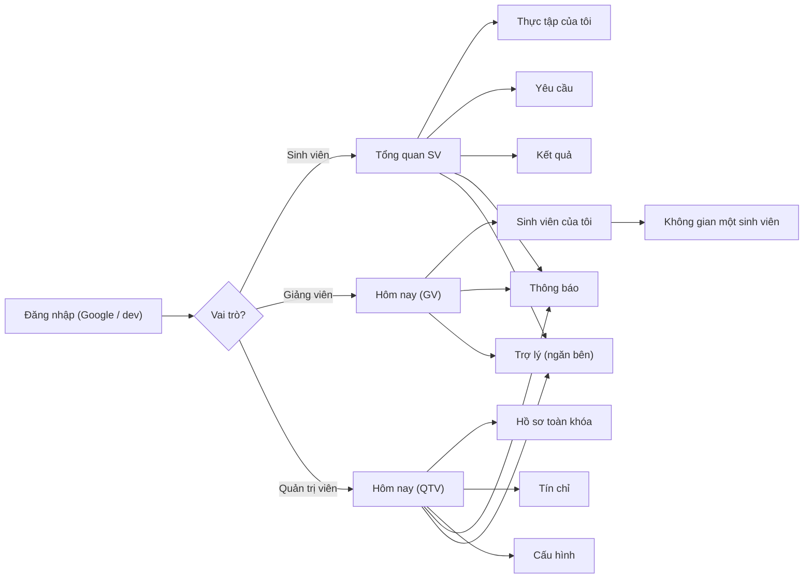

# Thiết kế screen flow (bản đề xuất 0.1)

Mục tiêu: người dùng **luôn biết mình đang ở đâu, việc tiếp theo là gì, và bấm một lần để làm**. Không cần học hệ thống mới biết dùng.
Phạm vi: FE theo vai trò (`/student`, `/lecturer`, `/admin`), dùng lại API hiện có. Tài liệu này là **đề xuất thiết kế**, chưa phải code.

## 1. Vấn đề của giao diện hiện tại

| Vấn đề | Biểu hiện | Hệ quả |
|---|---|---|
| Menu phẳng, theo **tính năng** | SV có 9 mục (Hồ sơ, Đề cương, Mốc, Nhật ký, Yêu cầu, Kết thúc, Bảng điểm, Trợ lý...) | SV phải tự đoán mình đang ở bước nào |
| Trang chủ là bảng | `StudentHome` hiện trạng thái + bảng mốc | Không thấy toàn cảnh hành trình |
| Việc cần làm là một dòng chữ | "Việc cần làm tiếp" nằm trong Card | Dễ bỏ sót, không nổi bật |
| GV phải chuyển nhiều trang để duyệt | Hàng chờ → mở hồ sơ → quay lại | Chậm khi có nhiều sinh viên |
| Cờ, yêu cầu, hàng chờ tách rời | `/lecturer/flags`, `/lecturer/requests`, `/lecturer` | GV phải tự gom việc |
| Trợ lý chat nằm riêng một trang | `/assistant` | SV đang điền hồ sơ phải rời trang mới hỏi được |
| Cấu hình rải rác | QTV có 9 mục menu | Khó tìm |

## 2. Nguyên tắc thiết kế

1. **Một việc chính mỗi màn hình.** Mỗi trang có đúng một nút nổi bật ("Nộp hồ sơ", "Duyệt"). Việc phụ để dạng liên kết.
2. **Hành trình trước, tính năng sau.** SV thấy một thanh tiến trình (hồ sơ → đề cương → thực tập → kết thúc → tín chỉ) thay vì danh sách mục.
3. **Gom việc theo người, không theo loại.** Mỗi vai trò có một "Hôm nay" (hộp việc) gom mọi thứ cần họ xử lý.
4. **Duyệt tại chỗ.** GV xử lý ngay trong bảng điều khiển bên phải, không chuyển trang.
5. **AI luôn là gợi ý, người luôn bấm xác nhận.** Gợi ý AI có nhãn riêng ("Gợi ý của AI"), hiện nguồn/độ tin cậy, và cần bấm chấp nhận. Không bao giờ tự lưu hay tự quyết.
6. **Nói rõ vì sao và làm gì tiếp.** Mọi trạng thái bị chặn nêu lý do bằng tiếng Việt và có nút/liên kết đi tới việc gỡ chặn (ví dụ "Chưa đủ 8 tuần: còn thiếu 2 tuần").
7. **Trợ lý ở mọi nơi.** Nút nổi góc phải, mở ngăn chat bên cạnh, biết trang đang xem.
8. **Trạng thái trống có hướng dẫn.** Không để bảng rỗng trơ trọi: nói vì sao rỗng và làm gì.
9. **Ít lựa chọn hơn.** Tối đa 5 mục menu chính mỗi vai trò; phần còn lại là tab bên trong.
10. **Lý do bắt buộc đặt ngay trong thao tác** (từ chối, trả lại, bác cờ), không bật hộp thoại gây gián đoạn.

## 3. Cấu trúc điều hướng đề xuất

| Vai trò | Menu hiện tại | Đề xuất (tối đa 5) |
|---|---|---|
| Sinh viên | 9 mục | **Tổng quan** · **Thực tập của tôi** (tab: Hồ sơ / Đề cương / Mốc & minh chứng / Nhật ký) · **Yêu cầu** · **Kết quả** (tín chỉ + bảng điểm) · Thông báo (chuông) · Trợ lý (nút nổi) |
| Giảng viên | 7 mục | **Hôm nay** (hộp việc, gộp hàng chờ + cờ + yêu cầu) · **Sinh viên của tôi** · **Báo cáo** (dashboard) · Thông báo · Trợ lý |
| Quản trị viên | 9 mục | **Hôm nay** · **Hồ sơ toàn khóa** · **Tín chỉ** (chờ phê duyệt + việc đồng bộ LMS) · **Cấu hình** (tab: Mốc / Chuẩn đầu ra / Ngoại lệ / Quy định / LMS / Tài khoản) · **Báo cáo** (dashboard + audit) · Thông báo · Trợ lý |

Thanh trên cùng cố định: logo, mục menu, chuông thông báo (có số chưa đọc), tên người dùng + vai trò, đăng xuất.

## 4. Luồng tổng thể



## 5. Luồng sinh viên

### 5.1. Hành trình (thanh tiến trình trên trang Tổng quan)


Bước hiện tại tô đậm; bước xong có dấu ✓; bước chưa tới mờ. Bấm vào bước đã qua để xem lại.

### 5.2. Các màn hình và việc chính

| # | Màn hình | Việc chính (một nút nổi bật) | Ghi chú |
|---|---|---|---|
| S1 | **Tổng quan** | Nút lớn theo trạng thái: "Hoàn thiện hồ sơ" / "Nộp đề cương" / "Nộp mốc M3" ... | Trên cùng: tiến trình + thẻ **Việc cần làm** (tối đa 3, xếp theo hạn). Dưới: mốc sắp tới, thông báo mới, yêu cầu đang chờ |
| S2 | **Hồ sơ** (wizard 3 bước) | "Tiếp tục" → "Nộp cho giảng viên" | Bước 1 tải giấy tiếp nhận (kéo-thả); bước 2 **AI gợi ý điền**, từng trường có nút ✓ chấp nhận / sửa; bước 3 xem lại + nộp. Lưu nháp tự động |
| S3 | **Đề cương** | "Nộp đề cương" | Soạn có gợi ý chuẩn đầu ra (chọn bằng chip); hiện phiên bản và lý do GV yêu cầu sửa ngay đầu trang |
| S4 | **Mốc & minh chứng** | "Tải minh chứng và nộp" trên từng mốc | Dạng **dòng thời gian** M1→M5: hạn, trạng thái, còn bao nhiêu ngày. Mốc bị trả lại hiện lý do màu cảnh báo |
| S5 | **Nhật ký** | "Viết nhật ký tuần này" | Lịch tuần: tuần đã nộp / thiếu / chưa tới. Tuần thiếu có nút "Bổ sung" |
| S6 | **Yêu cầu** | "Tạo yêu cầu" (gia hạn hoặc ngoại lệ) | Chọn loại → form ngắn → đính kèm minh chứng. Danh sách có trạng thái và người duyệt |
| S7 | **Kết quả** | "Nộp kết thúc để xét tín chỉ" | **Danh sách điều kiện T1–T6** dạng ✓/✗ kèm giá trị và việc gỡ chặn. Nút nộp chỉ bật khi đủ điều kiện nộp |

### 5.3. Màn hình then chốt: Tổng quan sinh viên

```
┌ VIN-15   Tổng quan · Thực tập của tôi · Yêu cầu · Kết quả          🔔3  SV A ▾ ┐
│                                                                                   │
│  ① Hồ sơ ──✓── ② Đề cương ──✓── ③ THỰC TẬP ───── ④ Kết thúc ───── ⑤ Tín chỉ     │
│                                  tuần 5/12                                        │
│                                                                                   │
│  ┌ Việc cần làm ───────────────────────────────────────────────────────────────┐ │
│  │ ⚠ Mốc M3 quá hạn 2 ngày          [ Nộp mốc M3 ]                             │ │
│  │ ○ Nhật ký tuần 08/12 còn thiếu   [ Viết nhật ký ]                           │ │
│  └─────────────────────────────────────────────────────────────────────────────┘ │
│  ┌ Mốc sắp tới ─────────────┐  ┌ Mới nhất ──────────────────────────────────────┐ │
│  │ M3 Báo cáo giữa kỳ  14/1 │  │ Cô Lan đã duyệt đề cương (hôm qua)             │ │
│  │ M4 Báo cáo cuối kỳ  21/2 │  │ Hệ thống nhắc: nhật ký tuần 08/12              │ │
│  └──────────────────────────┘  └────────────────────────────────────────────────┘ │
│                                                                      [💬 Trợ lý]  │
└───────────────────────────────────────────────────────────────────────────────────┘
```

## 6. Luồng giảng viên

### 6.1. Màn hình

| # | Màn hình | Việc chính | Ghi chú |
|---|---|---|---|
| G1 | **Hôm nay** (hộp việc) | Chọn một mục → xử lý ngay bên phải | Gom hàng chờ duyệt + cờ rủi ro + yêu cầu, xếp theo mức ưu tiên (hạn gần, rủi ro cao, chờ lâu). Lọc nhanh: Tất cả / Cần duyệt / Cờ / Yêu cầu |
| G2 | **Sinh viên của tôi** | Mở một sinh viên | Bảng có thanh tiến độ, mức rủi ro, mốc kế tiếp; sắp theo "cần chú ý trước" |
| G3 | **Không gian một sinh viên** | Tùy tab | Tab: Tổng quan · Hồ sơ · Đề cương · Mốc & minh chứng · Nhật ký · Yêu cầu · Tín chỉ. Đầu trang: tên, trạng thái, cờ đang mở |
| G4 | **Báo cáo** | Xem / xuất CSV | Dashboard phạm vi của mình |

### 6.2. Màn hình then chốt: Hôm nay (duyệt tại chỗ)

```
┌ Hôm nay · Sinh viên của tôi · Báo cáo                                  🔔  Cô Lan ▾ ┐
│ Lọc: [Tất cả 12] [Cần duyệt 5] [Cờ 4] [Yêu cầu 3]                                   │
│ ┌ Danh sách ────────────────┐ ┌ Chi tiết ─────────────────────────────────────────┐ │
│ │ 🔴 SV C · Cờ: quá hạn M3  │ │ SV C · Đề cương v2 · nộp 2 giờ trước              │ │
│ │ 🟠 SV B · Duyệt đề cương  │ │ ┌ Gợi ý của AI ───────────────────────────────┐   │ │
│ │ 🟠 SV A · Yêu cầu gia hạn │ │ │ Tóm tắt: xây API đặt lịch bằng FastAPI...    │   │ │
│ │ ⚪ SV D · Nhật ký mới      │ │ │ ✓ LO1 phủ  ✗ LO2 chưa rõ                     │   │ │
│ │                           │ │ │ Lưu ý: chưa nêu kế hoạch từng tuần           │   │ │
│ │                           │ │ └ (chỉ gợi ý, GV quyết định) ──────────────────┘   │ │
│ │                           │ │ Nội dung đề cương ...                              │ │
│ │                           │ │ Lý do (bắt buộc nếu trả lại): [____________]       │ │
│ │                           │ │ [ Duyệt ]  [ Yêu cầu sửa ]  [ Từ chối ]            │ │
│ └───────────────────────────┘ └────────────────────────────────────────────────────┘ │
└──────────────────────────────────────────────────────────────────────────────────────┘
```
- **Tiền thẩm AI chạy sẵn** khi mở mục (hoặc nút "Tóm tắt" nếu muốn tiết kiệm chi phí), hiển thị trong khung riêng gắn nhãn.
- Duyệt xong mục chuyển sang mục kế tiếp trong danh sách (không phải quay lại).
- Cờ rủi ro: hiện **lý do + bằng chứng + gợi ý**; nút Ghi nhận / Đã xử lý / Bác bỏ (bác bỏ bắt buộc lý do).
- Phím tắt (tùy chọn): `J/K` chuyển mục, `A` duyệt.

## 7. Luồng quản trị viên

| # | Màn hình | Việc chính | Ghi chú |
|---|---|---|---|
| Q1 | **Hôm nay** | Xử lý mục chờ | Cùng khung hai cột như GV, nhưng gồm yêu cầu ảnh hưởng tín chỉ, hồ sơ chờ phê duyệt tín chỉ, việc đồng bộ LMS lỗi |
| Q2 | **Hồ sơ toàn khóa** | Lọc / xuất CSV | Lọc theo trạng thái, giảng viên, khóa; gán giảng viên ngay trong bảng (chọn từ danh sách thả) |
| Q3 | **Tín chỉ** | "Phê duyệt" / "Không duyệt (lý do)" | Hiện kết quả thẩm định của GV, bảng T1–T6, bảng điểm LMS; sau khi duyệt hiện trạng thái đồng bộ LMS |
| Q4 | **Cấu hình** | Lưu | Tab: Mốc mẫu · Chuẩn đầu ra (theo khóa) · Loại ngoại lệ · **Quy định** (nạp → xem trước → xuất bản) · LMS (học phần, điểm, tiên quyết, việc đồng bộ) · Tài khoản (mời, gán GV) |
| Q5 | **Báo cáo** | Xem / xuất CSV | Dashboard toàn khóa + audit (tab) |

Quy trình nạp quy định (Q4): dạng bước 1 Nạp → 2 Xem trước các đoạn đã tách → 3 Xuất bản, mỗi bước có nút tiếp tục rõ ràng và cảnh báo "bản cũ sẽ bị đóng".

## 8. Thành phần dùng chung

| Thành phần | Mô tả | Thay thế cho |
|---|---|---|
| **Thanh tiến trình hành trình** | 5 bước, tô đậm bước hiện tại | Dòng chữ "Việc cần làm tiếp" |
| **Thẻ Việc cần làm** | Tối đa 3 việc, có nút hành động | Bảng mốc ở trang chủ |
| **Khung hai cột (danh sách + chi tiết)** | Dùng ở GV/QTV | Trang hàng chờ + trang chi tiết riêng |
| **Hộp gợi ý AI** | Nhãn "Gợi ý của AI", nút chấp nhận, độ tin cậy, nguồn | Văn bản thuần |
| **Danh sách điều kiện ✓/✗** | T1–T6 kèm lý do và cách gỡ | Bảng điều kiện |
| **Ngăn Trợ lý** | Nút nổi → ngăn phải, giữ nguyên trang đang làm | Trang `/assistant` riêng (vẫn giữ làm toàn màn hình) |
| **Chuông thông báo** | Menu thả, số chưa đọc, bấm đi tới đúng nơi | Trang thông báo riêng |
| **Trạng thái trống / lỗi / đang tải** | Có minh họa ngắn, lý do, hướng đi | Bảng rỗng |
| **Chọn lý do** | Ô lý do ngay trong thao tác từ chối | Hộp thoại |

## 9. Từ vựng trạng thái (thống nhất cho mọi màn hình)

Dùng **một cặp màu + nhãn** cho từng trạng thái, không thay đổi giữa các trang:
- Xanh: xong / đạt (đã chấp nhận, đã duyệt, hoàn thành).
- Vàng: đang chờ người khác (đã nộp, chờ duyệt, chờ thẩm định).
- Cam: cần **bạn** làm (yêu cầu sửa, bị trả lại, sắp đến hạn).
- Đỏ: quá hạn / bị chặn / bị từ chối.
- Xám: chưa tới / đã đóng.

Nhãn dùng ngôn ngữ của người dùng, không dùng mã nội bộ (`pending_credit` → "Chờ thẩm định tín chỉ").

## 10. Truy cập, di động, ngôn ngữ

- Tiếng Việt toàn bộ; ngày dạng `dd/mm/yyyy`; số ngày còn lại/quá hạn viết rõ.
- Sinh viên dùng **điện thoại** nhiều: ưu tiên bố cục một cột, nút lớn, tải ảnh minh chứng từ camera. GV/QTV ưu tiên máy tính.
- Tương phản màu đạt WCAG AA; trạng thái không chỉ phân biệt bằng màu (kèm biểu tượng/chữ).
- Mọi hành động có phản hồi (toast "Đã nộp", "Đã lưu bản nháp"); lỗi nêu nguyên nhân và cách khắc phục.

## 11. Đối chiếu với code hiện tại

| Màn hình đề xuất | Hiện có | Việc cần làm |
|---|---|---|
| Tổng quan SV | `StudentHome` (bảng) | Thêm thanh tiến trình + thẻ Việc cần làm |
| Hồ sơ (wizard) | `InternshipForm` (một form dài) | Tách 3 bước, AI gợi ý từng trường |
| Đề cương, Mốc, Nhật ký | Trang riêng | Gộp thành tab "Thực tập của tôi"; mốc dạng dòng thời gian |
| Kết quả | `FinalPage`, `GradesPage` | Gộp; hiện T1–T6 ✓/✗ có cách gỡ |
| Hôm nay (GV/QTV) | `QueuePanel` + `FlagsPanel` + `RequestsReview` | Gộp thành khung hai cột duyệt tại chỗ |
| Không gian một SV | `InternshipDetailView` | Chia tab, thêm hộp tiền thẩm AI |
| Cấu hình | `ConfigPanel`, `LmsAdminPanel`, `PoliciesPanel`, `AccountsPanel` | Gộp vào một trang có tab |
| Ngăn Trợ lý | `/assistant` | Thêm nút nổi + ngăn bên (giữ trang riêng) |
| Chuông thông báo | `/notifications` | Thêm menu thả trên thanh trên |

BE đã có đủ API cho các màn hình trên; chỉ thiếu **một endpoint gộp** "Hôm nay" nếu muốn giảm số lần gọi (hiện `/api/queue`, `/api/flags`, `/api/requests/pending` có thể gộp ở FE).

## 12. Thứ tự làm đề xuất

1. **Khung chung:** thanh trên + menu rút gọn + chuông thông báo + từ vựng trạng thái + trạng thái trống/lỗi.
2. **Sinh viên:** Tổng quan (tiến trình + Việc cần làm) → Mốc dạng dòng thời gian → Hồ sơ wizard → Kết quả T1–T6.
3. **Giảng viên:** Hôm nay hai cột (duyệt tại chỗ, tiền thẩm AI) → không gian một sinh viên có tab.
4. **Quản trị viên:** Tín chỉ → Cấu hình gộp tab.
5. **Ngăn Trợ lý nổi** và đánh bóng (di động, phím tắt).

Mỗi bước nên kết thúc bằng một lần mở trình duyệt đi qua thật theo vai trò (chưa từng làm), kèm chụp màn hình.

## 13. Câu hỏi cần chốt

1. Có làm **di động** cho sinh viên ngay đợt này không, hay ưu tiên máy tính trước?
2. Tiền thẩm AI **tự chạy khi GV mở mục** hay chỉ khi bấm (khác nhau về chi phí LLM)?
3. Có dùng thư viện giao diện (ví dụ shadcn/ui, Tailwind) hay giữ CSS hiện tại (`ui.module.css`)?
4. Có giữ trang `/assistant` toàn màn hình song song với ngăn bên không?
